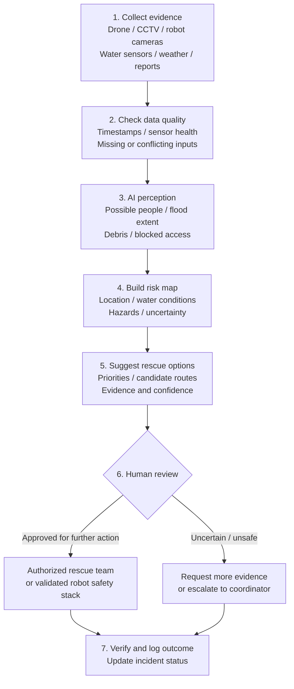

# Flood Rescue AI

## Flood Rescue AI — Concept visualization


*Illustrative design concept only. This image is not evidence of a built, tested, validated, or operational system. Capabilities shown remain proposed unless separately documented and verified.*

## Cinematic video concept and interactive 4D-style simulation

Explore the proposed hybrid rescue robot in a synthetic urban flood environment. The concept combines four articulated walking legs with a buoyant chassis/pontoons for controlled shallow-water movement, with responder-supervised assistance for people and animals.

- **[Open cinematic video concept](docs/demos/flood-rescue-cinematic-video-concept.html)** — animated 75-second storyboard with play/pause, timeline scrubbing, urban reconnaissance, walking/float concept, human assistance, animal assistance and responder handover.
- **[Open interactive 4D-style simulation](docs/demos/flood-rescue-interactive-4d-simulation.html)** — time-evolving isometric scene with movement controls, selectable urban/residential/tower/rural scenarios, simulated flood depth from 0–6 m, rain intensity, hybrid/walk/float modes, route display and synthetic person/animal markers.

**What “4D-style” means here:** an interactive 3D-style/isometric illustration changing over time, implemented as self-contained HTML Canvas. It is not a physics-accurate digital twin, real-time flood map, trained perception system, validated navigation stack or live robot feed. Depth and rain are illustrative scenario controls, not real measurements or certified operating limits. The demo uses no external libraries or paid APIs and sends no commands to hardware.

**Rescue and safety boundary:** all people and animals are synthetic scene markers, not detected victims. The robot concept does not autonomously lift people or animals; trained responders direct contact and handover. The demo enters a simulated safe-hold state at the highest depth setting, but this is only a software illustration, not proof of real-world safety. No field rescue, amphibious performance, waterproofing or physical robot capability is claimed.


## Project at a glance

| Topic | Current position |
|---|---|
| Project type | AI-assisted flood reconnaissance and rescue robotics research prototype |
| Available software | Local decision-support logic, regression tests, dataset/validation tooling, and documented demo/simulation workflows |
| Robot architecture | Ground robot, boat, and drone coordination is a proposed development direction; complete physical deployment is not demonstrated |
| AI and rescue performance | No representative held-out benchmark currently establishes real-world victim detection, flood mapping, or rescue success |
| Safety boundary | Software checks and simulation are not proof of field safety; no autonomous real-world rescue readiness is claimed |
| Development approach | Simulation-first, local-first, and free/open-source where practical |
| Immediate focus | Freeze versioned scenarios, measure route safety and task outcomes, inject sensor/communication faults, and record recovery behavior |

**Explore:** [Complete-system blueprint](docs/COMPLETE_SYSTEM_BLUEPRINT.md) · [Validation matrix](docs/VALIDATION_MATRIX.md) · [Local simulation quickstart](docs/LOCAL_SIMULATION_QUICKSTART.md) · [Automated tests](https://github.com/Pui89/Flood-Rescue-AI/actions)

## Local fault-monitoring software (initial implementation)

A small, dependency-light Python module accepts explicit fault reports, suggests conservative responses, and keeps a bounded in-memory event log. It includes automated unit tests and a GitHub Actions test workflow. It is not an antivirus, intrusion detector, gunshot detector, or physical safety controller; hardware shutdown, persistent audit storage, alerts, and real-world threat detection require separate implementations and validation.

- [Fault monitor integration guide](docs/FAULT_MONITOR_INTEGRATION.md)
- [Fault monitor source](apps/pui89_safety/fault_monitor.py)
- [Fault monitor tests](tests/test_fault_monitor.py)


## Fail-safe operating modes (design requirements)

The rescue-robot concept should use three modes: **AI operation**, **limited safe operation**, and **manual recovery**. If AI, perception, localization, or communications become unreliable, the system must not continue a risky rescue task or enter unsafe water. Rescue actions require a conservative stop/hold response, an operator alert, and manual control where available.

- **AI operation:** AI may assist with detection and route proposals; independent safety controls and a human operator govern hazardous movement.
- **Limited safe operation:** no rescue manipulation or hazardous movement; only a verified safe action may continue when all required sensors, localization, communication, and power reserve are healthy.
- **Manual recovery:** stop autonomous mission actions, keep hazardous actuators disabled, alert the operator, and follow a recovery procedure.

**Status and limitation:** these are documented design requirements, not evidence that a physical rescue robot has been built or validated. Any vehicle, boat, or drone requires independent emergency stop, manual override, loss-of-link behaviour, and staged simulation/physical testing before field use.

- [System fault, hardware, electrical, and recovery playbook](docs/SYSTEM_FAULT_AND_HARDWARE_SAFETY.md)

## Project status — 22 October 2026

**Current stage:** rule-based operator decision support and software regression testing; not a validated autonomous rescue robot.

- **Verified CI:** the latest Python tests, Flood Rescue regression checks, and agent unit tests completed successfully. [Latest Python-test run](https://github.com/Pui89/Flood-Rescue-AI/actions/runs/39729381023) · [Latest regression-check run](https://github.com/Pui89/Flood-Rescue-AI/actions/runs/39729380999).
- **Implemented:** input validation and safety gates for supplied sensor status, localization, water depth, route clearance, and possible-person alerts; human operators retain rescue decisions.
- **Next milestone:** freeze a lawful, versioned dataset or clearly labelled synthetic scenario set; run repeatable simulation tests; report mapping/navigation outputs, failure cases, and fail-safe behaviour with exact test conditions.
- **Limits:** passing unit tests does not establish real-world flood navigation, victim detection, waterproofing, or rescue capability. Simulation and field results must be reported separately.


## Free decision-support agent (current scope)

**Additional cost for this rule-based agent: $0.** It uses the repository's Python code and supplied inputs; it does not require a paid AI API, cloud service, or model download. Local Python/test tooling and GitHub usage remain subject to their own terms and limits.

**What it does:** Checks supplied sensor status, localization, water depth, route clearance, and possible-person alerts. It does not autonomously navigate or perform a rescue.

```text
Sensor / perception inputs → localization and route-safety checks → operator alert or STOP → human rescue decision
```

- **Run guide:** [Agent guide](docs/AGENT_GUIDE.md)
- **Important limitation:** this is a rule-based decision-support prototype, not proof of real-world performance. Hardware, optional third-party services, or future model training may have separate costs.
 Application

> **Product quality standard:** [benchmark protocol and fair comparison criteria](docs/PRODUCT_BENCHMARK_STANDARD.md). Simulation results must remain separate from real-world rescue claims.

> **Next research milestone — simulation evidence:** choose a lawful, versioned dataset or a clearly labelled synthetic scenario; freeze test cases; record detection/mapping outputs and failure cases; then test route planning and fail-safe behaviour in simulation. Report measurable results only for the exact tests run. Passing software tests or concept imagery does not establish real-world flood navigation, victim detection, or rescue capability. Start with the [validation matrix](docs/VALIDATION_MATRIX.md) and [validation/commercial roadmap](docs/VALIDATION_AND_COMMERCIAL_ROADMAP.md).


## Run the agent tests

Run the focused, lightweight unit tests locally with Python 3.10 or newer:

```bash
python -m pip install pytest
python -m py_compile agents/project_agent.py tests/test_project_agent.py
python -m pytest -q tests/test_project_agent.py
```

A dedicated [GitHub Actions workflow](https://github.com/Pui89/Flood-Rescue-AI/actions/workflows/agent-tests.yml) is configured to run the agent tests on Python 3.10, 3.11, and 3.12 when relevant files change. Check the Actions page for the actual run status; adding this workflow does not itself mean the tests have passed.

## Support, sponsorship and open-source collaboration

PUI89 welcomes robotics and disaster-response research feedback, simulation testing, safety-focused code review, open-source contributions, introductions to authorised stakeholders, and scoped sponsorship discussions.

- **Support and sponsorship brief:** [ways to collaborate with PUI89](https://github.com/Pui89/Pui89.github.io/blob/main/SUPPORT_AND_SPONSORSHIP.md)
- **Project website:** [PUI89 AI Robotics](https://pui89.github.io/)
- **Open-source resources and support pathways:** [project resource guide](docs/OPEN_SOURCE_FREE_RESOURCES_AND_SUPPORT.md)

Contributions should improve reproducibility, simulation, reliability, or safety. This remains a research/prototype project; real rescue capability and field performance are not claimed.

## Latest engineering update — 21 October 2026

- **Safety-gate hardening merged:** [PR #25](https://github.com/Pui89/Flood-Rescue-AI/pull/25) is merged. It rejects extremely large localization-confidence inputs safely and adds a regression test for `10**10000`. This is software-level input-validation evidence only; check the PR's Actions results for the exact CI status.
- **Existing software boundary:** the deterministic safety gate validates candidate actions in software; it does not directly command hardware and is not a certified safety controller.
- **Evidence boundary:** passing software tests cannot establish real-world flood navigation, amphibious mobility, human evacuation performance, or physical rescue safety. Simulation and supervised validation remain necessary.


## Robot concept illustration


*Original concept artwork—not a live sensor feed, field-tested vehicle, or evidence of a real rescue.*


> **Complete-system architecture and acceptance gates:** [COMPLETE_SYSTEM_BLUEPRINT.md](docs/COMPLETE_SYSTEM_BLUEPRINT.md). This is a build-and-validation plan, not a claim of field-validated rescue.
> **Current validation matrix:** [VALIDATION_MATRIX.md](docs/VALIDATION_MATRIX.md) — implementation evidence, automated checks, and remaining unvalidated capabilities.
> **Engineering assurance plan:** [ENGINEERING_ASSURANCE_PLAN.md](docs/ENGINEERING_ASSURANCE_PLAN.md) — project requirements, hazard log, verification/validation gates, and evidence rules.

## Local Hugging Face model plan

This repository's recommended local model, intended tasks, licence checks, setup notes, and no-surprise-billing rules are documented in **[HUGGINGFACE_LOCAL_MODELS.md](docs/HUGGINGFACE_LOCAL_MODELS.md)**.

**Cost boundary:** the plan uses downloaded local weights only; it does not require paid Hugging Face inference, cloud GPUs, paid notebooks, or a subscription. Model integration and performance must be verified by running tests locally.

**Dataset and labelling workflow:** see [dataset sources, licence checks, annotation and training plan](docs/DATASET_ACQUISITION_AND_LABELING.md), the [Windows opt-in dataset helper](scripts/prepare_free_datasets.ps1), the [image inventory/manifest generator](tools/dataset_inventory.py), the [manifest template](data/manifest.template.csv), the [group-aware train/validation/test splitter](tools/group_split_manifest.py), and the [local manifest audit tool](tools/audit_dataset_manifest.py). Downloads require local user confirmation; no images are automatically considered licensed or correctly labelled. Keep datasets and weights out of Git.

[Detailed project status, checks, next steps and future plan](docs/PROJECT_STATUS_2026-10-18.md)

## Product brief

See [docs/PRODUCT_BRIEF.md](docs/PRODUCT_BRIEF.md) for a concise description of the problem, current evidence, intended audiences, demonstration plan and milestones for potential partners and product stakeholders.

## Latest automated CI verification — 20 October 2026

The latest Python test workflow passed on the current main-branch change in [run 39276988264](https://github.com/Pui89/Flood-Rescue-AI/actions/runs/39276988264). The workflow includes the dataset-tool checks and deterministic end-to-end demo. This is software-level evidence only; it does **not** validate real-world person detection, safe navigation, or a rescue outcome.

## Latest status update — 20 October 2026

- **Current status: software prototype and evaluation planning.** The validation matrix was refreshed on 20 October to match [the latest passing CI run](https://github.com/Pui89/Flood-Rescue-AI/actions/runs/39276988264). This is evidence for those automated checks only, not proof of real-world person detection, flood mapping, navigation or rescue.
- **Data readiness:** dataset sourcing, source-rights/licence checks, annotation, manifest auditing and group-aware splitting remain required before training or reporting real-image metrics. A dataset source or scene-segmentation label must not be treated as a validated person-detection label.
- **Next checks:** audit permitted data and labels; freeze leakage-safe splits; establish separate baselines for person detection and flood-scene segmentation; report held-out precision/recall, false negatives, latency and failure cases; then test missing/stale/conflicting sensors, communication loss and fail-closed behavior in repeatable simulation.
- **Not yet demonstrated:** independently validated victim/person detection, validated water-depth estimates, safe real-world navigation, physical rescue, or field-tested robot safety. Synthetic observations and concept images are not real model detections.
- **Future path:** reproducible ROS 2/Nav2/Gazebo scenarios, sensor-failure and stop tests, independent safety review, and only then any authorised, supervised hardware or field trial.
- **Cost and safety boundary:** keep the workflow cost-conscious and local-first where feasible; do not claim a rescue outcome or allow an AI hypothesis to replace trained human responders.

## Previous status update — 18 October 2026

- **Successful:** Python CI passed on 3.10/3.11/3.12 in [run 39096446071](https://github.com/Pui89/Flood-Rescue-AI/actions/runs/39096446071); repository has workflow/safety tests, dataset manifest tools and a benchmark protocol. This does not establish real-world detection or rescue performance.
- **Continuing:** verify dataset licences and labels; test missing/stale/conflicting sensors, uncertainty, communication loss and fail-closed behavior.
- **Next:** separate flood-scene segmentation from person detection; audit manifests and data splits; run repeatable fixed-seed scenarios and report failures as well as successes.
- **Future:** evaluate geographic/weather shifts, then reproducible ROS 2/Nav2/Gazebo simulation and independent safety review before any hardware/field trial.
- **Corrections:** FloodNet scene labels do not prove person detection; synthetic observations are not model detections; a supplied collision-check flag is not itself a collision checker. No real rescue performance is validated. Open-source-first.


## Project status overview — updated 18 October 2026

**Current stage: software prototype and safety/regression testing. Not yet a field-validated rescue robot.**

| Status | What it means today |
|---|---|
| **Successful** | The main-branch Python CI run passed; deterministic simulation and software-level safety checks are available. The workflow includes audit-evidence consistency checks and safeguards that require human review and do not authorize actuator commands. |
| **In progress** | Improving repeatability, documenting the validation protocol, and preparing the project for measured experiments. |
| **Not yet demonstrated** | Reliable person detection on independent real flood imagery; validated flood segmentation/depth estimates; real-world navigation performance; physical rescue or field safety. |
| **Next** | (1) Select a lawful, licensed dataset and record its version; (2) define train/validation/test splits before training; (3) train or integrate a baseline detector/segmenter; (4) report precision, recall, false negatives, latency and failure cases on held-out data; (5) test navigation and fail-safe behavior in simulation. |
| **Future** | Reproducible multi-scenario simulation, sensor-failure and communication-loss tests, hardware-in-the-loop testing, then controlled field trials with qualified safety oversight. |

**Evidence boundary:** CI success means the tested software checks passed; it does not mean a trained model achieved real-world accuracy or that a robot has rescued anyone. No real-world model metrics should be claimed until a documented independent evaluation exists. See the [validation and commercial roadmap](docs/VALIDATION_AND_COMMERCIAL_ROADMAP.md) and [GitHub Actions](https://github.com/Pui89/Flood-Rescue-AI/actions).

---

## AI Application Overview

### How the Flood Rescue AI application works

The application is designed to help trained emergency coordinators understand a flood scene and review possible rescue actions. It is a **human-supervised decision-support prototype**; this workflow does not imply that all capabilities are implemented or validated in real flood conditions.



**In plain language:** sensors and images provide evidence; AI highlights possible people and hazards; mapping combines those findings with water and access information; the system proposes priorities and routes; a trained person verifies the proposal; and the team records what happened. Uncertain detections must remain uncertain—not be treated as proof that someone is safe or has been rescued.

| Stage | What the application does | Important limitation |
|---|---|---|
| Collect | Receives recorded/live images, sensor readings and reports | Data may be delayed, incomplete or unavailable |
| Detect | Flags possible people, floodwater, debris and blocked routes | Rain, reflections, occlusion and darkness can cause false alarms or misses |
| Map | Combines locations, hazards, water conditions and confidence | Maps and water estimates require verification |
| Plan | Suggests candidate priorities and safer routes | A suggestion is not a guarantee that a route is safe |
| Review | Shows evidence and uncertainty to a human coordinator | A trained responder remains responsible for operational decisions |
| Verify | Records confirmed status and new observations | Loss of camera contact does not prove a rescue succeeded |


*Concept illustration only—not a live sensor feed, a recorded robot demonstration, or proof of validated field performance. Start with recorded or simulated data; real deployments require rescue-agency authorization, independent safety testing and validated safeguards.*

### Real flood reference from Thailand and AI-robot use case


*Historical real-world photograph: the Government of Thailand's photographer documented flood conditions in Hat Yai, Songkhla, on 2 November 2010. Wikimedia Commons lists the photograph under [CC BY 2.0](https://creativecommons.org/licenses/by/2.0/); attribution: Government of Thailand / photographer Peerapat Wimolrungkarat. [Original image and licence details](https://commons.wikimedia.org/wiki/File:Amphoe_Hat_Yai_flood.jpg). This photo is a visual context reference, not robot training data.*

**Real satellite flood evidence from Thailand:** GISTDA published Sentinel-1A satellite analysis of flooding in northern Thailand on 23 August 2024, including affected areas around Chiang Rai, Phayao, Sukhothai and nearby provinces. The agency notes that satellite-derived flooded-area estimates are preliminary and need ground verification. [View GISTDA's original satellite report and images](https://www.gistda.or.th/ewtadmin/ewt/gistda_web/news_view.php?lang=EN&n_id=8041). GISTDA also published high-resolution THEOS-2 imagery of flooded areas in Sukhothai in August 2025: [official satellite report](https://gistda.or.th/th/news/gistda-%E0%B9%80%E0%B8%9C%E0%B8%A2%E0%B8%A0%E0%B8%B2%E0%B8%9E%E0%B8%96%E0%B9%88%E0%B8%B2%E0%B8%A2%E0%B8%94%E0%B8%B2%E0%B8%A7%E0%B9%80%E0%B8%97%E0%B8%B5%E0%B8%A2%E0%B8%A1-5/).

**How an AI robot could help in Thai floods (proposed research use cases):**
- **Reconnaissance before responders enter:** use cameras, depth sensing and LiDAR to map water-covered roads, debris, damaged access routes and visible hazards.
- **Search support:** detect possible people or distress cues from robot-mounted cameras/thermal sensors, mark locations and send evidence to trained rescue coordinators. A detection is only a lead; occlusion, rain, reflections and warm objects can cause misses or false alarms.
- **Safer route planning:** combine the robot's local map with official flood maps, water-level reports and blocked-road information to propose routes, while a separate safety controller prevents unsafe motion.
- **Supply delivery and communication relay:** in a suitable, validated amphibious or surface platform, carry lightweight supplies or a radio relay to accessible locations; never assume the robot can safely enter fast-flowing or electrically hazardous water.
- **Situation dashboard:** combine timestamped observations, uncertainty, sensor-health status and human-confirmed reports to help prioritize inspections and coordinate response.

**Practical development path:** start with public satellite reports and appropriately licensed photographs as contextual references, then use legally accessible, labelled datasets and simulated flood scenes for evaluation. Measure victim-detection recall, false alarms, mapping error, route safety, communications reliability and performance in rain, darkness and partial submersion. Before field trials, require rescue-agency authorization, independent safety testing, privacy protections and human supervision.

**Evidence boundary:** these are proposed applications, not evidence that this repository's robot has been used in a Thai flood or has validated victim-detection/rescue performance. The 2010 photograph and GISTDA satellite images are contextual references, not a labelled training dataset. External image hosting can change; no paid image subscription is needed for the CC BY photo under its stated licence, but this does not guarantee every future hosting, cloud or AI service will remain available at no additional cost.

AI application concept for flood reconnaissance and rescue support, combining multimodal sensing, hazard mapping, uncertainty-aware planning, and human-supervised mission proposals.


> **Status and evidence:** This repository documents a research/prototype workflow. The illustration is concept artwork, not a live demonstration or proof of field performance. Reported capability and performance must be supported by reproducible tests and benchmark results.

### Platform scope: AI application + embodied robotics

**This platform is designed to support both an AI application and embodied AI in a robot.** These are two connected layers of one research platform:

- **AI application layer (runs on a computer):** process image/sensor datasets, detect and localize possible people or hazards, build flood/hazard maps, estimate uncertainty, visualize evidence, and prepare reviewable rescue-route or mission proposals.
- **Embodied robotics layer (robot-facing architecture):** connect perception and planning to a simulated or physical search-and-rescue robot through interfaces such as ROS 2, with localization, mapping, navigation, obstacle checks, communications/telemetry, and independent safety supervision.
- **Shared pipeline:** sensor/data quality → perception and mapping → 3D/temporal scene representation → uncertainty-aware planning → safety validation → human review and audit.

The AI application can be developed and evaluated on a computer without robot hardware. The embodied layer is the intended robotics integration path; **this architecture and concept artwork do not prove completed physical robot integration, validated victim detection, autonomous navigation, or rescue capability.** Begin with synthetic/recorded data and simulation, then require measured benchmarks and independent safety validation before hardware trials.

### Interactive Flood Rescue AI application example

Try the local web dashboard to review a simulated flood scene and submit manually entered observations to the existing API. You can change camera/thermal/LiDAR availability, timestamp alignment, water-depth/current estimates and a possible-person track, then inspect the API's safety status and export a JSON report.

**Run it locally** from the repository root:

```bash
python -m pip install -r apps/pui89_app/requirements.txt
```

Terminal 1:
```bash
uvicorn apps.pui89_app.main:app --reload
```

Terminal 2:
```bash
streamlit run apps/pui89_app/web_demo.py
```

- [Dashboard source](apps/pui89_app/web_demo.py)
- [Dashboard and API instructions](apps/pui89_app/README.md)
- [OpenAPI interactive docs](http://127.0.0.1:8000/docs) (available after starting the API)

**Important:** this is a local example, not a hosted public demo. Uploaded photos are preview-only; the dashboard does not run a trained vision model on them. Results come from manually entered values and the repository's existing illustrative rules. It does not dispatch responders or control a robot, and it cannot certify a route as safe.

### Quick start

Clone the renamed repository and install the project dependencies:

```bash
git clone https://github.com/Pui89/Flood-Rescue-AI.git
cd Flood-Rescue-AI
python -m pip install --upgrade pip
python -m pip install -e .
python demo_end_to_end.py
pytest -q
```

The end-to-end demo and tests are intended for local development with the project's documented inputs. Start with synthetic or recorded data; do not connect the prototype directly to physical actuators or use it as the sole basis for consequential decisions.

**Workflow:** sensor/data quality checks → perception and multimodal evidence → 3D/temporal scene representation → uncertainty and unknown-case handling → reviewable plan or screening proposal → audit record.

**Documentation:** [End-to-end simulation guide](docs/END_TO_END_SIMULATION.md) · [Simulation directory](simulation/)

### Animated AI application demo

## PUI89 AI Robotics Platform

**Autonomous multimodal embodied-AI platform for flood reconnaissance and rescue support.**

This repository is one vertical implementation of the **PUI89 AI Robotics** platform for disaster response. The common architecture is:

```text
Multimodal Sensors
      ↓
Quality / Health Gate
      ↓
Perception + Tracking
      ↓
3D / 4D World Model
      ↓
Uncertainty + OOD
      ↓
Foundation-Model Reasoning
      ↓
Task Planning
      ↓
Deterministic Safety Supervisor
      ↓
ROS 2 / Robot Control
      ↓
Telemetry / Evidence
      ↓
MLOps / Fleet Learning
```

### Product tiers

- **PUI89 Research** — universities, researchers, and potential product partners
- **PUI89 Professional** — rescue organizations, municipalities, infrastructure operators
- **PUI89 Enterprise** — large corporations, governments, logistics, ports, infrastructure

### Cross-environment research

The same perception/world-model/uncertainty/safety interfaces are designed to transfer between agriculture, disaster response and security/inspection. Transfer must be measured with the repository benchmark; it is not assumed from architecture alone.

- [Optional DINOv2 + Anomalib integration, end-to-end verification and tests](docs/OPEN_SOURCE_VISION_INTEGRATION.md)
- [ROS 2 + Nav2 + Gazebo Sim + Open3D integration guide and environment preflight](docs/ROBOTICS_STACK_INTEGRATION.md)
- [Executable end-to-end mission reference, CLI, fail-closed checks and CI](docs/E2E_MISSION_VERIFICATION.md)

### Evidence standard

This project separates **targets, prototypes and measured results**. Production or field-validation claims require reproducible benchmark evidence, failure testing, and documented safety validation.

See:
- [PUI89 Benchmark](docs/PUI89_BENCHMARK.md)
- [Cross-Environment Transfer Benchmark](docs/PUI89_TRANSFER_BENCHMARK.md)
- [Product Tiers](docs/PUI89_PRODUCT_TIERS.md)
- [Failure and UNKNOWN Protocol](docs/PUI89_FAILURE_AND_UNKNOWN_PROTOCOL.md)
- [MLOps Model Lifecycle](docs/PUI89_MLOPS_MODEL_LIFECYCLE.md)
- [12-Month Roadmap](docs/PUI89_12_MONTH_ROADMAP.md)
- [Cost Safety and Billing Policy](docs/COST_SAFETY_AND_BILLING.md)

### Commercial open-source stack and release readiness

- [Commercial open-source integration plan](docs/OPEN_SOURCE_COMMERCIAL_STACK.md) — DINOv2, Anomalib, Open3D, ROS 2 Nav2, ONNX Runtime, nvblox, optional Visual SLAM, licensing gates, and staged integration.
- [Optional stack manifest](config/open_source_stack.yaml) — optional backends remain disabled until adapters, license review, and validation pass.
- [Commercial readiness checklist](docs/COMMERCIAL_READINESS_CHECKLIST.md) — software supply chain, sensor/robot validation, safety, benchmark evidence, and commercial operations.
- [Commercial implementation plan](docs/COMMERCIAL_IMPLEMENTATION_PLAN.md) — Jetson Orin/AGX Orin deployment, component/license shortlist, repository implementation map, integration order, release gates, and product packaging.
- [Integration and fault-injection test plan](docs/INTEGRATION_TEST_PLAN.md) — proposed unit, adapter, replay, fault-injection, HIL, and release-gate tests.
- [Flood Recon v1 benchmark protocol](benchmarks/flood_recon_v1.yaml) — benchmark metadata, scenarios, metrics, and acceptance policy; protocol only, not measured results.

These additions define the integration plan and configuration intent; they do **not** claim every listed package has been installed or integrated into the live robot. Validate each adapter on target hardware before enabling it.

A safety-aware multimodal perception and robotics platform for flood rescue operations. The repository combines depth estimation, multi-object tracking, spatial hazard extraction, embodied AI, multimodal reasoning, world modeling and safety-aware robot action planning.

## Overview

## Professional Engineering Baseline

This repository is being developed as a safety-aware multimodal flood-rescue robotics platform. The engineering boundary is:

**AI proposes -> deterministic robotics validates -> safety system controls -> action is verified and logged.**

Key professional layers now documented in the repository:

- reproducible Python packaging with runtime, development and GPU dependency profiles;
- CI/security hardening with linting, tests, coverage, dependency review, CodeQL and Dependabot;
- sensor synchronization, calibration, health and provenance as first-class deployment requirements;
- explicit uncertainty, OOD, abstention and human-review states;
- 3D/4D world-model and evidence-provenance direction;
- simulation-first validation and a flood-specific robustness scenario matrix;
- deterministic collision, reachability, exclusion-zone and emergency-stop boundaries;
- benchmark definitions covering perception, tracking, navigation, robustness, calibration and safety.

See:

- [Engineering roadmap](docs/ENGINEERING_ROADMAP.md)
- [Safety architecture](docs/SAFETY_ARCHITECTURE.md)
- [Evaluation benchmark](docs/EVALUATION_BENCHMARK.md)
- [Simulation scenarios](docs/SIMULATION_SCENARIOS.md)

**Implementation status:** prototype/research engineering. No capability is presented as field-validated unless repeatable measurements are available.

Flood rescue requires robots to perceive unstable terrain, detect victims, avoid obstacles, and prioritize safe navigation under poor visual conditions. This project models that pipeline in a modular, deployable way.

## New Flood Rescue AI Robot Concept


**Concept:** a flood-response robot with an elevated RGB/thermal camera mast, LiDAR/depth sensing, flotation support, tracked mobility for suitable terrain, a removable first-aid/radio supply pod, and a human-supervised mission dashboard. The design illustrates a possible research direction; it is not a photograph of a built robot, a working prototype, or evidence of field performance.

**Safety-first workflow:** AI flags possible people and hazards → the system reports evidence and uncertainty → deterministic checks and a trained coordinator review proposals → only an authorized, validated control system may execute a response. Unknown or occluded targets remain unconfirmed. Never send an unvalidated robot into fast-flowing, electrically hazardous, or otherwise unsafe floodwater.

**Image note:** this is an original SVG vector illustration stored in this repository. It requires no paid stock-photo subscription or paid image-generation API to view or reuse under the repository's applicable license. Third-party assets and software elsewhere in the project may have separate terms.

## 3D Robot Concept


**Concept features:** amphibious flotation and thrusters, RGB-D/thermal/NIR/LiDAR perception, rescue manipulator, 3D semantic world modeling, multimodal AI reasoning, and a deterministic safety gate.

See [docs/3D_ROBOT_CONCEPT.md](docs/3D_ROBOT_CONCEPT.md) for the design concept.

## Real-time upgrade

The system supports live processing from a webcam or RTSP stream. The pipeline estimates depth per frame, tracks detected objects, builds a hazard map, and overlays the result in a live OpenCV window.

## Embodied AI architecture

RGB / thermal / NIR / depth / LiDAR / IMU -> YOLO + SAM3 + tracking -> 3D semantic world model -> Qwen3-VL + Gemma 4 E4B reasoning -> V-JEPA2 future prediction -> GR00T N1.7 / FLUX 3 Action candidate actions -> deterministic safety gate -> ROS2/Nav2 + MoveIt2/RRT* -> robot -> action verification.

### Models and roles

- YOLO: fast detection and tracking.
- SAM 3: open-vocabulary segmentation, occlusion boundaries and video tracking.
- Qwen3-VL: primary multimodal scene and rescue reasoning.
- Gemma 4 31B IT: high-capacity multimodal flood-scene reasoning, victim verification, occlusion analysis, route/debris reasoning and rescue-plan cross-checking.
- Gemma 4 E4B-it: lightweight fallback multimodal reasoning.
- LeRobot: datasets, teleoperation, training and deployment.
- SmolVLA, pi0/pi0.5, X-VLA, VLA-JEPA: action/VLA candidates.
- NVIDIA GR00T N1.7 3B: embodied action-policy candidate for adaptation to the flood-robot embodiment.
- FLUX 3 Action Base: world-action adaptation base; not a complete robot policy and requires an embodiment-specific action head.
- V-JEPA2/VLA-JEPA: temporal world-model and future-state prediction.
- LTX-2.5-Diffusers: offline synthetic video/audio scenario generation and visual diversity.
- MiniMax H3 Turbo LoRA: offline synthetic audio-visual scenario generation and rare-event prototyping.
- RGB-D + LiDAR + Open3D: 3D semantic mapping.
- Thermal + NIR + depth/LiDAR: darkness and low-visibility perception.
- Isaac Sim + Isaac Lab: realistic 3D robot simulation, synthetic data and sim-to-real testing.

## Gemma 4 31B IT multimodal reasoning

The repository integrates [google/gemma-4-31B-it](https://huggingface.co/google/gemma-4-31B-it) as a multimodal reasoning model for flood-rescue scene interpretation. It accepts image + text inputs through Transformers and can also be served with vLLM. The model weights are downloaded at runtime and are not committed to this repository.

Recommended flow:

RGB / thermal / NIR / depth / LiDAR -> perception + tracking -> 3D semantic scene -> **Gemma 4 31B IT** -> structured rescue decision -> VLA/action candidates -> deterministic safety gate.

Gemma 4 31B IT is advisory only: it cannot directly command motors, navigation actuators, or rescue mechanisms. Unknown or occluded people/objects must be re-observed, and every candidate action remains subject to collision checking, exclusion zones, sensor-health checks and emergency-stop logic.

## Safety

Foundation, generative and action models never bypass deterministic safety. Reasoning models propose priorities; action models propose candidate actions. Collision checking, human-exclusion zones, sensor-health checks, force/torque limits and emergency-stop logic remain authoritative.

See docs/EMBODIED_AI_STACK.md, docs/ADVANCED_MODEL_INTEGRATION.md, config/ai_stack.yaml, config/advanced_models.yaml and config/safety_forecasting.yaml.

## Installation

```bash
git clone https://github.com/Pui89/Flood-Rescue-AI.git
cd Flood-Rescue-AI
python -m venv .venv
source .venv/bin/activate
pip install -U pip
pip install -e .
```

## End-to-End Software Demo (Simulation-First)

Run the new safety-gated sensor-hypothesis pipeline with synthetic inputs:

```bash
python demo_end_to_end.py
python -m pytest tests/test_end_to_end.py -q
```

Details: [End-to-End Simulation Baseline](docs/END_TO_END_SIMULATION.md). This prototype checks input quality and timestamp alignment, aggregates supplied victim/hazard hypotheses, blocks proposals without an externally verified collision check, requires human approval, and never sends actuator commands. Synthetic hypotheses are not validated detections; the external collision-check flag is not itself a collision checker.

Existing grid-mission vertical slice: [E2E Mission Verification](docs/E2E_MISSION_VERIFICATION.md).

## Usage

Run the live real-time demo from a webcam:

```bash
python scripts/run_demo.py --source 0 --display
```

Run from an RTSP stream:

```bash
python scripts/run_demo.py --source "rtsp://username:password@ip:554/stream"
```

Run the smoke test:

```bash
pytest tests/test_tracker.py -q
```

## 3D / 4D Realistic Flood Rescue Robot Concept

The concept shows the flood-response robot operating in a dynamic disaster scene with RGB-D/LiDAR perception, thermal sensing, victim tracking, an articulated rescue arm, and a time-aware 4D trajectory.

- [3D/4D concept image](docs/flood_rescue_robot_3d_4d_concept.svg)
- [3D/4D video preview](docs/flood_rescue_robot_3d_4d_preview.mp4)

## Pipeline Overview

**Sense → Perceive → Localize → Reason → Plan → Safety Gate → Navigate → Rescue → Verify → Report**

See the full architecture and mission flow in [docs/PIPELINE_OVERVIEW.md](docs/PIPELINE_OVERVIEW.md).

## Research and product development

This project is being developed on three parallel tracks:

- **Real-world rescue robotics:** rugged mobility, multimodal sensing, GNSS-denied navigation, rescue payloads, degraded-mode operation and deterministic safety.
- **World-model research direction:** a proposed **Trustworthy 4D Rescue World Model (T4D-RWM)** connecting multimodal perception, temporal prediction, uncertainty/OOD, active perception and risk-aware action. This remains a development direction, not a validated capability; see the [3D/4D world model implementation](flood_robot/world_model.py) and [robustness benchmark](docs/ROBUSTNESS_BENCHMARK.md).

See also:
- [Research dataset specification](docs/RESEARCH_DATASET_SPEC.md)
- [Cybersecurity policy](SECURITY.md)
- [3D/4D world model implementation](flood_robot/world_model.py)

- **Product direction:** turn the validated software and simulation workflow into a dependable decision-support product, with repeatable tests, deployment documentation, operator review and explicit safety limits.

The project should not be judged by the number of AI models integrated. The key engineering target is **measurable end-to-end rescue performance under uncertainty and failure**.

## News

- Project updates, perception and embodied-AI integrations, simulation assets, safety changes, and evaluation milestones are tracked through Git history and project documentation.
- New capabilities are labeled by implementation status and are not presented as validated field performance unless measured results are available.

## Online API

**Status: Prototype / planned.**

A future service layer can expose perception, victim/obstacle localization, hazard mapping, route planning, rescue-plan proposals, telemetry, and safety-state inspection without allowing foundation models to directly control actuators.

Example request:

```json
{
  "request_id": "example-001",
  "modalities": ["rgb", "depth", "thermal", "lidar"],
  "mode": "rescue_assessment",
  "mission_id": "flood-01"
}
```

Example response:

```json
{
  "request_id": "example-001",
  "decision": "HUMAN_REVIEW",
  "victim_candidates": [],
  "hazards": [],
  "confidence": 0.0,
  "uncertainty": 0.0,
  "safety_gate": "NOT_EXECUTED",
  "evidence_provenance": {}
}
```

These are interface examples only, not measured performance. A production API should authenticate requests, validate schemas, preserve evidence provenance, and keep reasoning separate from deterministic control and emergency-stop paths.

## Online App

**Status: Prototype / planned.**

The planned web application can provide:

- live RGB/RGB-D/thermal/LiDAR sensor health
- synchronized flood-scene and robot views
- victim and hazard candidate visualization
- 3D semantic map and 4D trajectory view
- route/rescue-plan inspection
- uncertainty, occlusion, and sensor-health indicators
- robot telemetry and mission state
- safety-gate and emergency-stop state
- human review/approval workflow
- evidence provenance and audit history

The app is intended for monitoring and human oversight; it must not provide unrestricted AI-to-motor control.

## System Overview

```text
RGB / RGB-D / Thermal / NIR / LiDAR / IMU
                  |
          Sensor Synchronization
                  |
        Quality + Health Gate
                  |
   Detection + Segmentation + Tracking
                  |
       3D Semantic World Model
                  |
     Victim / Hazard Assessment
                  |
      Multimodal Scene Reasoning
                  |
       Temporal / 4D Prediction
                  |
       Route + Rescue Planning
                  |
        Uncertainty / OOD Checks
                  |
       HUMAN REVIEW / POLICY
                  |
       Deterministic Safety Gate
                  |
        ROS 2 / Nav2 / MoveIt 2
                  |
             Robot + Tools
                  |
       Action Verification + Report
```

The architecture intentionally separates multimodal reasoning from authoritative robot control.

## Model Variants and Input Specifications

| Variant | Input | Primary role | Status |
|---|---|---|---|
| RGB perception | RGB image/video | Person, vehicle, debris, structure detection | Prototype |
| RGB-D | RGB + aligned depth | 3D localization and geometry | Prototype |
| Thermal | Thermal image/video | Low-light and heat-signature evidence | Prototype |
| NIR | NIR image/video | Low-visibility complementary evidence | Planned |
| LiDAR | Point cloud | Mapping, obstacle geometry, traversable space | Prototype |
| Multimodal | RGB-D + thermal + LiDAR + optional NIR | Evidence fusion | Prototype |
| Temporal / 4D | Sequential multimodal observations | Tracking, motion and future-state estimation | Prototype |
| Open-set / anomaly | Multimodal features | Unknown/degraded-scene handling | Planned |
| Qwen3-VL | Image + text/evidence metadata | High-level multimodal rescue reasoning | Prototype |
| Gemma 4 31B IT | Image + text/evidence metadata | High-capacity reasoning and cross-checking | Prototype |
| VLA candidates | Vision/state/action context | Future embodied-action research | Planned |

Actual camera resolution, depth range, LiDAR density/FOV, thermal/NIR bands, FPS, calibration, synchronization and preprocessing depend on deployed hardware. Dataset and sensor provenance should be recorded for reproducibility.

## YOLO26 Models & Training

Integrated Ultralytics YOLO26 model matrix, flood-rescue dataset schema, training, validation, inference, export and robot integration workflow: [docs/YOLO26_MODELS_AND_TRAINING.md](docs/YOLO26_MODELS_AND_TRAINING.md).

## Model Architecture

The system is organized into six functional layers:

1. **Perception** — detection, segmentation, tracking, depth estimation and sensor-quality checks.
2. **Spatial intelligence** — RGB-D/LiDAR fusion, 3D semantic mapping, terrain and obstacle geometry.
3. **Temporal intelligence** — target-state estimation, tracking continuity and 4D future-state prediction.
4. **Multimodal reasoning** — Qwen3-VL/Gemma reasoning over grounded observations and metadata.
5. **Planning** — navigation, reachability, collision-aware rescue planning and task sequencing.
6. **Safety/control** — deterministic validation followed by ROS2/Nav2/MoveIt2 execution and verification.

```text
Sensors
  -> Perception
  -> 3D/4D World Model
  -> Multimodal Reasoning
  -> Plan Proposal
  -> Uncertainty/OOD Checks
  -> Deterministic Safety Gate
  -> ROS2/Nav2/MoveIt2
  -> Robot
  -> Verify + Log
```

Foundation and generative models are advisory components. They are never the final authority for actuation.

## Recommended Workflow

1. Calibrate RGB, depth, thermal/NIR and LiDAR sensors.
2. Verify timestamps, extrinsics, synchronization and sensor health.
3. Acquire flood-scene observations and reject degraded inputs when necessary.
4. Detect and track victims, obstacles, vehicles, structures and debris.
5. Fuse depth/LiDAR into a 3D semantic world model.
6. Track relevant targets and hazards over time.
7. Generate a route/rescue-plan proposal using deterministic planners plus approved AI reasoning.
8. Check uncertainty, missing modalities, occlusion, reachability, collision risk and exclusion zones.
9. Escalate ambiguous or high-risk situations to human review.
10. Run the deterministic safety gate and emergency-stop checks.
11. Execute only through validated ROS2/Nav2/MoveIt2 interfaces.
12. Verify the outcome and record telemetry, evidence provenance, failures and recovery actions.

## Local Deployment

**Status: Local development / prototype deployment.** Physical deployment must remain behind deterministic safety controls and authorized robot interfaces.

### Requirements

- Python 3.x
- Git
- PyTorch and project dependencies
- ROS 2/Nav2/MoveIt 2 for optional physical integration
- RGB/RGB-D/thermal/NIR/LiDAR/IMU hardware as configured
- Optional NVIDIA GPU
- Optional Isaac Sim, Isaac Lab or Gazebo

### Clone and Install

```bash
git clone https://github.com/Pui89/Flood-Rescue-AI.git
cd Flood-Rescue-AI
python -m venv .venv
source .venv/bin/activate
# Windows PowerShell:
# .venv\Scripts\Activate.ps1
python -m pip install --upgrade pip
python -m pip install -e .
```

### Validate the Environment

```bash
python --version
python -m pip check
pytest tests/test_tracker.py -q
```

Run the full test suite when available:

```bash
pytest -q
```

### Run the Local Demo

Webcam:

```bash
python scripts/run_demo.py --source 0 --display
```

RTSP:

```bash
python scripts/run_demo.py --source "rtsp://username:password@ip:554/stream"
```

Start with recorded or simulated data when validating new sensors, models or deployment configurations.

### Recommended Deployment Sequence

```text
Recorded / Simulated Data
        |
Environment + Dependency Validation
        |
Sensor Calibration + Time Synchronization
        |
Perception + Tracking
        |
3D Semantic World Model
        |
Multimodal Evidence + Reasoning
        |
Uncertainty / OOD Assessment
        |
Human Review / Mission Policy
        |
Deterministic Safety Gate
        |
ROS 2 / Nav2 / MoveIt 2
        |
Authorized Robot Interface
        |
Action Verification + Audit Log
```

### Sensor Deployment Checklist

Record sensor model/configuration, resolution, frame rate, FOV/range, intrinsic/extrinsic calibration, timestamp synchronization, preprocessing/model versions, sensor-health state, missing modalities, mission identifier, evidence provenance, reviewer decision and outcome.

Missing, degraded or contradictory modalities should preserve uncertainty or `UNKNOWN` rather than forcing a confident rescue classification.

### ROS 2 / Robotics Integration Boundary

```text
Sensors -> Perception -> 3D/4D World Model -> Reasoning
                                                   |
                                                   v
                                             Human Review
                                                   |
LiDAR + Depth + IMU -> SLAM -> Planner -> Safety Gate -> ROS 2
```

Foundation, generative and action models must not directly command motors, propulsion, manipulators or other actuators. Deterministic collision checks, exclusion zones, sensor-health checks, force/torque limits and emergency-stop behavior remain authoritative.

### Troubleshooting

- **Install fails:** verify Python and project packaging/dependencies.
- **Tests fail:** fix the local environment before physical deployment.
- **Camera/RTSP fails:** check permissions, stream URL, network access and OpenCV backend.
- **Sensor data is missing/unsynchronized:** stop and correct calibration/time synchronization.
- **ROS 2 unavailable:** use recorded data or simulation.
- **Low confidence or modality disagreement:** retain uncertainty and escalate to human review.

### Development Principle

Validate recorded/simulated data first, then perception, uncertainty and safety behavior, and only then connect hardware incrementally. No unvalidated foundation-model output may bypass the deterministic safety layer or directly actuate the robot.
## Full 2K-Workflow

**2K is a target high-resolution workflow, not a guaranteed camera specification.**

```text
2K RGB acquisition
      -> quality + synchronization checks
      -> resize/crop/preprocess
      -> person/victim/hazard detection
      -> segmentation + tracking
      -> thermal/NIR/depth/LiDAR alignment
      -> 3D semantic fusion
      -> 4D target/hazard-state tracking
      -> multimodal reasoning
      -> uncertainty / OOD assessment
      -> route + rescue-plan proposal
      -> deterministic safety gate
      -> human review / authorized execution
      -> action verification
      -> provenance + telemetry + audit log
```

Actual throughput and latency depend on camera, GPU/CPU, memory, preprocessing, model size, sensor synchronization and deployment configuration.

## Prompting Guidance

Foundation models should act as evidence-grounded reasoning assistants, not unrestricted robot controllers.

Recommended prompt structure:

```text
ROLE:
Flood-rescue evidence and planning assistant.

INPUT:
Only supplied RGB/RGB-D/thermal/NIR/LiDAR observations,
robot state, target metadata and explicit safety constraints.

TASK:
1. Summarize observable evidence.
2. Identify victim/hazard candidates and missing or degraded modalities.
3. Report contradictions, occlusion and uncertainty.
4. Propose a high-level rescue/navigation plan.
5. Preserve UNKNOWN when evidence is insufficient.
6. Recommend HUMAN_REVIEW when risk or uncertainty is high.

CONSTRAINTS:
Do not invent observations.
Do not inflate confidence.
Do not bypass deterministic safety rules.
Do not issue unrestricted motor commands.
Do not execute outside the validated control layer.
```

Gemma, Qwen and other foundation models remain subordinate to deterministic safety logic and authorized robot-control policy.

## License

MIT. See the repository license for the applicable terms. Third-party models, datasets, simulators, SDKs and checkpoints may have separate licenses and usage restrictions.

## Contact Us

GitHub: [Pui89/flood-rescue-ai-robot](https://github.com/Pui89/Flood-Rescue-AI)

Use GitHub Issues and Discussions for technical questions, collaboration, bug reports, feature requests, and research/engineering feedback.

## Project website

The PUI89 Flood Recon project website introduces the product scope, system architecture, benchmark protocol, engineering roadmap, safety boundaries, and third-party licensing policy.

- Website entry point: [index.html](index.html)
- [Architecture diagram](docs/architecture.svg)
- [Benchmark protocol](docs/benchmark-protocol.md)
- [Engineering roadmap](docs/roadmap.md)
- [Safety and operating boundaries](docs/safety.md)
- [Third-party licensing policy](docs/third-party-licenses.md)
- [Website deployment instructions](docs/website-deployment.md)

The GitHub Pages workflow is at [\.github/workflows/pages.yml](.github/workflows/pages.yml). After merging the website to `main`, set **Settings → Pages → Source** to **GitHub Actions**. The expected project URL is https://pui89.github.io/flood-rescue-ai-robot/ after a successful deployment.

The site describes a research prototype; it does not claim measured benchmark results, safety certification, or readiness for real floodwater operations.

## Open-source tools, funding and hardware support

See [Open-Source Resources, Funding, Compute and Hardware Support](docs/OPEN_SOURCE_FREE_RESOURCES_AND_SUPPORT.md) for open-source tools, eligible grant and cloud-credit routes, potential hardware-loan contacts, project-specific priorities, and 2026–2028 planning. Support is competitive and subject to each program's current eligibility and terms; no funding or hardware is guaranteed.

## Optional Local Voice Alerts

This project includes an optional guide for adding local text-to-speech announcements with no hosted inference API required. Start with the [Voice Alerts guide](docs/VOICE_ALERTS.md). This is documentation and a manual smoke test only; voice output is not yet connected to live project events or validated for field use.

## Robot Design Concept

See the [low-cost robot design concept and staged safety plan](docs/ROBOT_DESIGN.md). This is a concept and prototype roadmap, not a claim of a tested or field-ready robot. The initial approach prioritizes local software, existing hardware, no paid hosted APIs, and human supervision.

## Interactive visual simulation (no external packages required)

Open [the standalone visual flood simulation](demos/visual_flood_sim.html) in a browser, or view its [source on GitHub](https://github.com/Pui89/Flood-Rescue-AI/blob/main/demos/visual_flood_sim.html). It includes a synthetic hazard map, step-by-step rover movement, a proposed route, possible-person markers, an event log, and buttons to inject communication loss or an unknown hazard and trigger a fail-closed stop.

The page uses only browser-native HTML, CSS and JavaScript: no install, network request, API, subscription, cloud GPU or hardware connection is required. **All map cells and person markers are synthetic.** This is not flood physics, a trained detector, or proof of safe navigation/rescue.

## Runnable local simulation (no external packages required)

A synthetic 2D reconnaissance simulation using the Python standard library is available at [`scripts/flood_rescue_sim.py`](scripts/flood_rescue_sim.py), with a Windows guide at [`docs/LOCAL_SIMULATION_QUICKSTART.md`](docs/LOCAL_SIMULATION_QUICKSTART.md) and standard-library tests at [`tests/test_flood_rescue_sim.py`](tests/test_flood_rescue_sim.py).

From Command Prompt in the repository folder:

```bat
python scripts\flood_rescue_sim.py
python scripts\flood_rescue_sim.py --seed 7 --fail-comms-at 2 --out runs\comms_failure
python -m unittest discover -s tests -v
```

**Evidence status:** the script implements grid-based shortest-path planning, simulated movement, scripted possible-person markers, event logging, JSON/CSV export, and injected communication-loss safe-stop behavior. The map and observations are synthetic; no trained perception model, ROS/Gazebo, physical robot, flood physics, or real rescue is demonstrated. Outputs are software-simulation results only, not field-performance or safety validation. This section supplements the README; existing content is preserved.


---

## Validation status, training, testing and measured results

**Evidence status:** this repository contains a local API/dashboard for manually entered illustrative sensor observations and a deterministic software workflow. The documented end-to-end demo uses synthetic, hand-authored observations. The dashboard's uploaded image is preview-only and does not run a trained flood/person detector. No real-world accuracy, rescue success rate, route-safety result or trained-checkpoint result is claimed.

| Workstream | Current evidence | Status / next step |
|---|---|---|
| Application/API | Local API and review dashboard | Prototype; run a clean-install smoke test |
| Decision workflow | Quality, timestamp, uncertainty and human-approval gates | Software behavior only; add fault-injection tests |
| Labelled data | No verified task-specific benchmark established here | Obtain permitted data; label people, water masks, debris and hazards under separate schemas |
| Training | No verified trained flood/person checkpoint established here | Train one task-specific baseline after data and licence review |
| Evaluation | No real held-out metrics established here | Freeze test data and report class-wise metrics, failure cases and latency |
| Robotics | Concept architecture and simulation-first workflow | Physical robot and field performance not validated |
| Commercial readiness | Research/feasibility prototype | Not ready to sell as a validated rescue robot |

### Reproducible development sequence

1. Define a single task first: person detection, flood segmentation, hazard detection and route planning must be evaluated separately.
2. Collect lawfully usable data. Record source, licence/permission, event/location group, modality, annotation version, reviewer and privacy restrictions. Context photos are not automatically training data.
3. Label visible people/hazards with boxes and class names; create pixel masks for flood segmentation. Record occlusion and ambiguous cases explicitly.
4. Split by event, location or source to reduce near-duplicate leakage. Keep the final test split frozen.
5. Train a local baseline and record code commit, dataset checksum/version, split counts, package versions, random seed, device, configuration, elapsed time and checkpoint checksum.
6. Evaluate actual model predictions on the held-out set. For detection report precision, recall, F1 and AP; for segmentation report IoU/Dice. Include class counts, latency, device, and failures under rain, darkness, reflections, blur and occlusion.
7. Test software behavior separately: missing/stale/conflicting sensors, invalid inputs, uncertainty handling and fail-closed gates. Software tests are not model accuracy.
8. Validate robot motion separately in a physics-backed simulator with an independently tested collision checker, safe-stop behavior and human approval before any authorized hardware trial.

### Honest results and release gate

No real-dataset metrics are listed because this documentation update did not run training or a held-out evaluation. Synthetic fixtures show software behavior only. A publishable benchmark must include dataset provenance, annotation policy, frozen split counts, model/checkpoint checksum, exact reproduction command, machine-readable results and failure analysis.

**Buyer position:** suitable now for research collaboration, simulation evaluation and feasibility studies. Do not market it as a field-ready autonomous rescue robot. Commercial deployment requires independent safety review, agency authorization, privacy/security review, robust communications and safe-stop tests, measured perception/mapping performance, controlled field trials and customer-agreed acceptance criteria.

See the [validation and commercial roadmap](docs/VALIDATION_AND_COMMERCIAL_ROADMAP.md).


## Automated safety regression checks

The GitHub Actions test workflow now runs on pushes and pull requests affecting the core pipeline or tests, and can also be started manually. The end-to-end tests cover invalid timestamps, low-quality and misaligned observations, invalid candidate confidence, required human approval, blocked proposals when independent collision checks are missing, no actuator commands, and tampered audit digests.

Run locally after installing the project's development dependencies:

```bash
python -m pip install -e ".[dev]"
python -m pytest
python demo_end_to_end.py
```

A passing software test only verifies the tested software behavior. It does not validate a trained perception model, collision checker, simulator physics, physical robot, or field rescue performance. Check the [GitHub Actions workflow](.github/workflows/ci.yml) for automated test status.


## Decision-support agent (rule-based prototype)

A local, standard-library-only agent module is available in [`agents/project_agent.py`](agents/project_agent.py), with focused tests in [`tests/test_project_agent.py`](tests/test_project_agent.py) and integration notes in [`docs/AGENT_GUIDE.md`](docs/AGENT_GUIDE.md). It produces reviewable recommendations from supplied observations; it does not run a perception model, call a hosted API, or issue actuator commands. These rules and tests are not evidence of trained-model accuracy or real-world validation.


## Automation roadmap (free-first)

The GitHub Actions workflow runs on relevant changes, manual dispatch, and a weekly schedule. Each test run writes test counts to the workflow summary; inspect the run logs if a report is missing.

**Next automated milestones**
1. Keep unit tests, syntax checks, and the deterministic end-to-end demo reproducible.
2. Expand deterministic fault scenarios for sensor loss, localization failure, communication loss, low battery, unsafe water depth, blocked routes, and corrupted inputs.
3. Add manifest checks for source provenance, file hashes, human-verified labels, and source-group separation before evaluation.
4. Add repeatable simulation reports that separate simulated outcomes from real-world results and record failure cases.

**Safety gate:** automation can test software responses to reported faults; it cannot detect actual gunfire, malware, tampering, or physical danger without suitable sensors and validated integrations. Do not deploy a real rescue robot based on software tests alone.


---

## Free Local Automation Framework

This repository includes a shared PUI89 health-check script for repeatable, zero-cost local checks.

- [Automation guide](docs/PROJECT_AUTOMATION.md)
- [Local health-check script](scripts/pui89_project_health_check.py)

Run from the repository root:

```bat
python scripts\pui89_project_health_check.py
```

The checker verifies repository structure, scans Python source syntax, discovers test files, and prints a JSON report. It does not install packages, download models, use APIs, or call cloud services. To run tests, explicitly use `--run-tests`; pytest is run only if already installed.

**Project focus:** simulation scenario completeness, navigation/sensor/communications failure tests, safe-stop behavior and no claims of real rescue validation.

**Focused regression tests:** [Flood simulation regression tests](tests/test_flood_rescue_sim.py). Checks blocked-cell avoidance, reproducibility, communication-loss safe stop, no route behavior, and suppression of synthetic observations when the waypoint is not reached.

**Evidence boundary:** a syntax scan is not a full test run; passing tests do not establish field performance or safety. Report only verified outcomes and keep proposed features separate from demonstrated results.

**Failure and security response:** see [failure and security response matrix](docs/FAILURE_AND_SECURITY_RESPONSE.md). This records design requirements and evidence boundaries; it does not claim every response is implemented or validated.


## Autonomous systems (software-level supervisor)

- [Autonomous system architecture, project-specific inputs, tests, and safety limits](docs/AUTONOMOUS_SYSTEMS.md)
- [Supervisor implementation](pui89_autonomy/supervisor.py) · [unit tests](tests/test_autonomy_supervisor.py)

The supervisor evaluates supplied status values and recommends an advisory mode: autonomous candidate, safe hold, manual recovery, or stopped. It does not acquire sensor data or command hardware. An autonomous-candidate result is not a safety certification; physical systems require independent safety controls and validation.

## Free-first AI engineering stack

Use a small, reproducible toolchain for the simulation-first rescue-support prototype.

- **Perception and sensor processing:** OpenCV and PyTorch when a defined, lawful dataset and suitable local hardware are available.
- **Simulation and robotics:** prefer open-source local simulation components only when needed for a specific acceptance test; check each dependency's licence and laptop resource requirements before installation.
- **Automation:** Python scripts and GitHub Actions for repeatable checks and test summaries, subject to applicable GitHub quotas.
- **Testing and observability:** pytest, structured logs, versioned scenarios, and repeatable reports that distinguish synthetic/simulation evidence from field evidence.
- **Agent workflow:** retain the current rule-based decision-support approach; add LangGraph or another agent framework only for a demonstrated multi-step need.

**Cost and safety guardrails:** no paid API, cloud GPU, subscription, or automatic hardware control is required by this plan. Ask before introducing costs. AI output remains advisory; simulation results do not prove waterproofing, safe navigation, victim detection, or real-world rescue capability. Physical deployment requires independent safety systems and staged validation.
